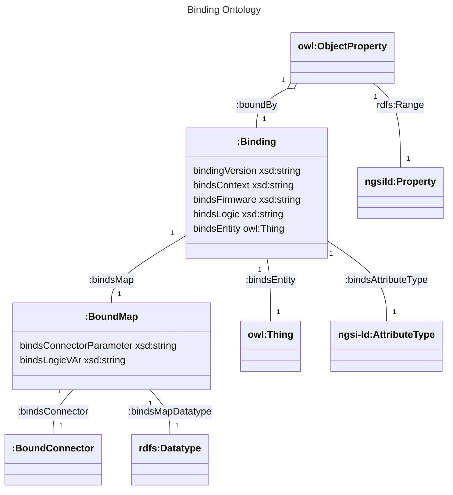

# Dataservice setup
Dataservice grabs data from different source and maps them into the data-model. The simplest setup is a 1:1 mapping which receives one value per NGSI-LD model parameter and forwards it directly. Advanced usecase is to get data from different sources and map it to a common model. A formal binding between the datamodel and the data sources is done and can be configured for different machine setup.
## OPCUA Module
Due to licency conflicts, the OPCUA module `asyncua` is NOT installed automatically and NOT statically used by the dataservice. Instead it must be installed manually from [pypi.org](https://pypi.org/project/asyncua/) or from the [GITHUB sources](https://github.com/FreeOpcUa/opcua-asyncio):

    pip3 install asyncua

## Setup and Activate Device
For this service to work, a multi-entity device activation is needed. That means that a device does not consist any longer of only one entity ID. A hierarchy of subcomponents with different device IDs can be supported.

## Binding Semantics

The terms needed for binding are described in https://industryfusion.github.io/contexts/staging/ontology/v0.1/binding.ttl.




### Classes
```
:Binding
    A binding contains all informations to calculate the value of a model attribute. For instance, to calculate ex:state you need to know where to get the metrics from (e.g. from a machine and an ontology) and how to calculate it e.g. take a numeric value from the machine and use the ontology to create an IRI.
Example:
    ex:myBinding a :Binding .
    ex:myBinding :bindsEntity urn:cutter:1 .
    ex:myBinding :bindsMap ex:map1 .
    ex:myBinding :bindsMap ex:map2 .
    ex:myBinding :bindingVersion "0.1"
    ex:myBinding :bindsFirmware "myFirmware"
    ex:myBinding :bindsLogic "WHERE { BIND(?var1) as ?value}"
    ex:myBinding :bindsAttributeType ngsi-ld:Property

:BoundMap
    A Bound Map contains a single map to define mapping from metrics to a model property. Several maps can be used to provide metrics for model properties. For instance it provides the rules to calculate the property ex:state with two maps:
Example:
    ex:map1 a :BoundMap .
    ex:map2 a :BoundMap .
    ex:map1 :bindsConnector :TestConnector .
    ex:map1 :bindsMapsDataType xsd:float .
    ex:map1 :bindsLogicVar "var1" .
    ex:map1 :bindsConnectorParameter 'mytestparam' .
    ex:map2 :bindsConnector :OPCUAConnector .
    ex:map2 :bindsMapsDataType xsd:boolean .
    ex:map2 :bindsLogicVar "var1" .
    ex:map2 :bindsConnectorParameter 'ns=3;i=5002' .
```
### Properties
```
:bindsLogic
    DataProperty: :bindsLogic
    Domain: 
        :Binding
    Range: 
        xsd:string
    Contains the "WHERE" part of a SPARQL expression. It is expected to deliver a ?value variable. The value can be build from BoundMap variables. If there is no bindslogic value and there is only one single BoundMap, the value is taken directly without SPARQL expression.

```
### SHACL Validation of Bindings

The basic structure of Bindings and Maps can be validated with SHACL. For instance the bindings in `examples/bindings.ttl` can be checked by

```
pyshacl -s validation/bindings-validation-shacl.ttl examples/bindings.ttl
```

`pyshacl` isn't a requirement of the dataservice. It is installed with the requirements of the model tools, `../opcua/requirements.txt`.

## Start the Dataservice

    python3 startDataservice.py <ontology-dir> <binding-file>

*\<ontology-dir\>* is a directory containing `entities.ttl`, `knowledge.ttl` (optional) and `context.jsonld`, and *\<binding-file\>* is the `*.ttl` file with the bindings. Relative paths, also those starting with `../`, are resolved against the working directory. The dataservice forwards the values to the device agent on TCP port 7070; `-p` changes the port and `-d` only prints them, without an agent. `python3 startDataservice.py --help` lists all options.

For instance, with the model of the pump example in `../opcua` (see below), as a dry run:

    python3 startDataservice.py -d ../opcua ../opcua/bindings.ttl

## OPC UA Example: From the Pump Nodeset to NGSI-LD

The [tutorial](opcua-pump-tutorial.md) takes the OPC UA pump example from its nodesets to live values in the context broker: building the model and the bindings, loading the entities, onboarding the device with its subcomponents, the test server, the dataservice, and reading the values over REST. It also lists what to change for another machine, and how to troubleshoot. The rules between the components on that path are specified in [contracts/opcua-live-data](../../openspec/specs/contracts/opcua-live-data/spec.md), and the [chain test](../../test/opcua-chain) runs the tutorial's commands on every Pull Request which touches them.

### Test Servers

There are two test servers. `tests/server/nodeset_server.py` serves the real nodesets with their values and data types. With `-w` clients can write the bound nodes, otherwise they are read-only and nothing ever changes. The tutorial shows how to start it.

`tests/server/binding_server.py` needs no nodesets. It creates a node for every map of a binding file and changes the values randomly every 5 seconds, except for the structures, which it cannot generate. Its endpoint is `opc.tcp://localhost:4840/freeopcua/server/`:

```
python3 tests/server/binding_server.py ../opcua/bindings.ttl
```

Both need `asyncua`, see [OPCUA Module](#opcua-module).

### How Values are Mapped

The bindings deliver a value in the same form as `instances.jsonld` has it:

| OPC UA | NGSI-LD | Binding |
|---|---|---|
| Numbers, Boolean, String, DateTime | `Property` with number, `true`/`false`, string, ISO 8601 timestamp | Value is taken over directly |
| Enumeration | `Property` with the IRI of the enum value, e.g. `{"@id": "http://opcfoundation.org/UA/Pumps/LiquidPump"}` | `bindsLogic` looks up the number in the knowledge of `entities.ttl`. A number which is not part of the Enumeration delivers no value |
| Structures, e.g. OptionSets | `JsonProperty` with `{"xsd:Body": {"xsd:<Type>": {"xsd:<Field>": ...}}}` and ByteStrings in base64 | `bindsAttributeType` is `ngsi-ld:JsonProperty` |

Arrays are not supported by the connector yet.

A node without a value and a read which fails do not deliver a value, so the context broker keeps the last known value. When the connection to the server is lost, the connector tries to connect again.
