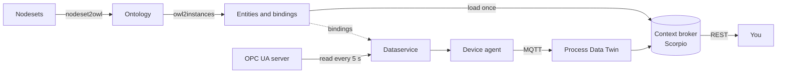

# From an OPC UA Server to Live Data in the Context Broker: The Pump Example

This tutorial takes an OPC UA pump from its nodeset files to live values you can read over a REST API.



The pump is only the example. [Using your own model](#using-your-own-model) lists what to change for another machine. The rules between the components on this path are specified in [contracts/opcua-live-data](../../openspec/specs/contracts/opcua-live-data/spec.md).

## What you need

### System requirements

| Requirement | Version | Used for |
|---|---|---|
| Linux | Tested on Ubuntu 24.04, also under WSL2 | Steps use GNU `sed -i`, `base64 -d`. macOS is untested |
| Python | **3.12** recommended. See below for others | Model tools, dataservice, test server |
| Node.js and `npm` | **22** in CI, which is also what the agent's own image uses; **24** tested by hand | Device agent |
| `make` | Tested with GNU Make 4.3 | Building the specifications |
| `curl`, `jq` | Tested with curl 8.5 and jq 1.7 | REST calls, reading the model |
| `kubectl` | Tested with client 1.35 | Reading the password and the MQTT address |

How far each version was tested. The chain test in [`test/opcua-chain`](../../test/opcua-chain) runs Steps 1, 2, 3, 6 and 7 of this tutorial on every Pull Request which touches the chain, and checks the values against the bridge and a real context broker, without a platform. Steps 4, 5 and 8 need a deployed platform and are tested by hand:

| Python | Install | Build the model | Test server and dataservice | Full tutorial with live data |
|---|---|---|---|---|
| 3.12 | CI | CI | CI | By hand, on 2026-11-07 with Node.js 24 |
| 3.10, used by the project's `Build` | CI | CI | CI | Not run |
| 3.13 | By hand | `owl2instances.py` only, by hand | By hand | Not run |

Both virtual environments together take about 350 MB, and the generated model about 36 MB.

### Your machine must reach

| What | Why |
|---|---|
| `raw.githubusercontent.com` | Downloading nodesets |
| `industryfusion.github.io` | The base ontology, while building the model |
| `pypi.org`, `registry.npmjs.org` | Installing packages |
| `ngsild.local`, `keycloak.local` | The broker's REST API and the access token. Both must resolve to the deployment |
| The `emqx-listeners` service, port 1883 | MQTT. The agent uses its external address |
| Your OPC UA server | Reading values. Port 4840 for the test server |

Ports 4840 (test server only) and 7070 (agent) must be free locally.

### The platform

- A running Process Data Twin with `Core Services` active. See the [deployment guide](../../helm/README.md).
- `kubectl` access to its `iff` namespace.
- This repository checked out. All commands start from its root directory.

You will use three long-running processes, so keep three extra terminals ready. Variables and functions from the main terminal aren't available in the others.

## Step 1: Install the tools

The model tools and the dataservice pin different `rdflib` versions, so they get separate virtual environments:

<!-- chain-test: install -->
```bash
python3 -m venv .venv-model
.venv-model/bin/pip install -q -r semantic-model/opcua/requirements.txt

python3 -m venv .venv-dataservice
.venv-dataservice/bin/pip install -q -r semantic-model/dataservice/requirements.txt asyncua
```

`asyncua` is installed by hand on purpose: because of its license, it isn't part of the dataservice's requirements.

## Step 2: Provide the nodesets

Someone has to provide the nodeset of your machine as XML. For the pump, that's the instance example published by the OPC Foundation, along with the companion specifications it builds on:

<!-- chain-test: nodesets -->
```bash
mkdir -p nodesets
BASE=https://raw.githubusercontent.com/OPCFoundation/UA-Nodeset/UA-1.05.03-2023-12-15
for f in DI/Opc.Ua.Di.NodeSet2.xml Machinery/Opc.Ua.Machinery.NodeSet2.xml \
         Pumps/Opc.Ua.Pumps.NodeSet2.xml Pumps/instanceexample.xml; do
  curl -fsS --retry 3 -o "nodesets/$(basename "$f")" "$BASE/$f"
done
ls nodesets
```

## Step 3: Build the model

First, translate the companion specifications the machine depends on. The make target fetches its own copies and takes about two minutes:

<!-- chain-test: specifications -->
```bash
cd semantic-model/opcua
PATH=$PWD/../../.venv-model/bin:$PATH make -f translate_default_nodesets.make pumps.owl.ttl
cd ../..
```

It prints warnings like `No server URI given (--serverUri). 348 dynamic node(s) ... are not exported`. They're expected here: a specification is translated in its global form, without any server's nodes.

Then translate the machine and create its entities and bindings:

<!-- chain-test: model -->
```bash
cd semantic-model/opcua
../../.venv-model/bin/python nodeset2owl.py ../../nodesets/instanceexample.xml \
    -i core.owl.ttl machinery.owl.ttl di.owl.ttl pumps.owl.ttl \
    -p instanceexample \
    -n http://yourorganisation.org/InstanceExample/ \
    --serverUri urn:example:opcua-server \
    -o instanceexample.owl.ttl
../../.venv-model/bin/python owl2instances.py \
    -t http://opcfoundation.org/UA/Pumps/PumpType \
    -sb \
    -n http://demo.machine/ \
    instanceexample.owl.ttl
jq length instances.jsonld
grep -c 'base:boundBy' bindings.ttl
cd ../..
```

You should see `20` entities and `46` bindings. These are the files you'll use from here on:

| File | Content |
|---|---|
| `instances.jsonld` | The entities for the context broker |
| `bindings.ttl` | Which OPC UA node feeds which attribute of which entity |
| `entities.ttl`, `context.jsonld` | Knowledge the dataservice needs, e.g. the enum values |
| `shacl.ttl` | Constraints for validation, not needed in this tutorial |

All of them are generated, so don't commit them. The same goes for `nodesets/`, the `.venv-*` directories and, in Step 5, the agent's `config/config.json` and `data/`.

## Step 4: Load the entities

Get an access token, then load the entities. Do this in your main terminal, because [Step 8](#step-8-watch-the-values) reuses the function:

```bash
token() {
  local password
  password=$(kubectl -n iff get secret/credential-iff-realm-user-iff -o jsonpath='{.data.password}' | base64 -d)
  curl -s -d client_id=scorpio -d username=realm_user --data-urlencode "password=$password" \
       -d grant_type=password http://keycloak.local/auth/realms/iff/protocol/openid-connect/token | jq -r .access_token
}

curl -s -o /dev/null -w 'HTTP %{http_code}\n' -X POST \
     -H "Authorization: Bearer $(token)" -H 'Content-Type: application/ld+json' \
     --data @semantic-model/opcua/instances.jsonld \
     http://ngsild.local/ngsi-ld/v1/entityOperations/upsert
```

`HTTP 201` means created, and `HTTP 204` means they already existed and were updated. Before any data arrives, a measurement such as the motor temperature reads `0`.

## Step 5: Onboard the device and start the agent

The dataservice doesn't talk to the broker directly: it hands values to the device agent, which sends them over MQTT. The pump is the device, and the other 19 entities are its subcomponents.

```bash
cd NgsildAgent
npm install --silent
cp config/config.json.template config/config.json
# The chart's MQTT service name only resolves inside the cluster, so use its external address
MQTT_HOST=$(kubectl -n iff get svc emqx-listeners -o jsonpath='{.status.loadBalancer.ingress[0].ip}')
sed -i "s/\"host\": \"emqx-listeners\"/\"host\": \"$MQTT_HOST\"/" config/config.json

ENTITIES=../semantic-model/opcua/instances.jsonld
PUMP=$(jq -r '.[] | select(.type == "pumps:PumpType") | .id' "$ENTITIES")
SUBCOMPONENTS=$(jq -r --arg pump "$PUMP" '.[] | select(.id != $pump) | "-d " + .id' "$ENTITIES")
PASSWORD=$(kubectl -n iff get secret/credential-iff-realm-user-iff -o jsonpath='{.data.password}' | base64 -d)
cd util
./init-device.sh $SUBCOMPONENTS "$PUMP" pumpgateway
./get-onboarding-token.sh -p "$PASSWORD" realm_user
./activate.sh -f
cd ../..
```

Now start the agent in a **second terminal** and leave it running:

```bash
cd NgsildAgent
node ./iff-agent.js
```

Look for `TCP listener started on port: 7070` and `DBIRTH Metric sent succesfully`.

## Step 6: Start the OPC UA server (test only)

> **Skip this step if you already have a server running your model.** Point the dataservice at it in Step 7. This test server only exists so that you can try the pump without any hardware.

In a **third terminal**, serve the nodesets. `-w` lets you write to the bound nodes, so you can simulate changes, because nodes of a nodeset are otherwise read-only:

<!-- chain-test: server -->
```bash
cd semantic-model/dataservice
../../.venv-dataservice/bin/python tests/server/nodeset_server.py \
    -e opc.tcp://127.0.0.1:4840/ \
    -x ../../nodesets/Opc.Ua.Di.NodeSet2.xml \
    -x ../../nodesets/Opc.Ua.Machinery.NodeSet2.xml \
    -x ../../nodesets/Opc.Ua.Pumps.NodeSet2.xml \
    -x ../../nodesets/instanceexample.xml \
    -w ../opcua/bindings.ttl
```

Wait for `Server running at opc.tcp://127.0.0.1:4840/`, which takes about 30 seconds.

There's also `tests/server/binding_server.py ../opcua/bindings.ttl`. It needs no nodesets and changes values randomly every 5 seconds, but its values aren't realistic, it can't serve structures, and its endpoint is `opc.tcp://localhost:4840/freeopcua/server/`.

## Step 7: Start the connector

The OPC UA connector is part of the dataservice. Start it in a **fourth terminal**, and set `OPCUA_TCP_CONNECT` to your server:

<!-- chain-test: dataservice -->
```bash
cd semantic-model/dataservice
OPCUA_TCP_CONNECT=opc.tcp://127.0.0.1:4840/ \
    ../../.venv-dataservice/bin/python startDataservice.py ../opcua ../opcua/bindings.ttl
```

It reads every bound node every 5 seconds and prints a line for each value it sends:

```text
sent [{"n": "http://opcfoundation.org/UA/Pumps/hasSpeed", "v": "0.0", "t": "Property", "i": "urn:uaentity:..."}]
```

`Warning: No knowledge file found.` is harmless here.

## Step 8: Watch the values

Back in the main terminal, ask for the motor temperature of the pump's drive. You don't need the long entity ID, because you can ask by type:

```bash
curl -s -G http://ngsild.local/ngsi-ld/v1/entities \
     --data-urlencode 'type=http://opcfoundation.org/UA/Pumps/DriveMeasurementsType' \
     --data-urlencode 'attrs=http://opcfoundation.org/UA/Pumps/hasMotorTemperature' \
     -H "Authorization: Bearer $(token)" -H 'Accept: application/json' | jq
```

The answer contains the current value, and `observedAt` tells you when it was measured:

```json
[
  {
    "id": "urn:uaentity:c3Z1PXVybjpleGFtcGxlOm9wY3VhLXNlcnZlcjtuc3U9aHR0cDovL3lvdXJvcmdhbmlzYXRpb24ub3JnL0luc3RhbmNlRXhhbXBsZS87aT01MDA2",
    "type": "http://opcfoundation.org/UA/Pumps/DriveMeasurementsType",
    "http://opcfoundation.org/UA/Pumps/hasMotorTemperature": {
      "type": "Property",
      "value": 0,
      "observedAt": "2026-11-05T12:00:00.000Z"
    }
  }
]
```

To keep watching it, poll every few seconds:

```bash
while true; do
  curl -s -G http://ngsild.local/ngsi-ld/v1/entities \
       --data-urlencode 'type=http://opcfoundation.org/UA/Pumps/DriveMeasurementsType' \
       --data-urlencode 'attrs=http://opcfoundation.org/UA/Pumps/hasMotorTemperature' \
       -H "Authorization: Bearer $(token)" -H 'Accept: application/json' \
    | jq -r '.[0]["http://opcfoundation.org/UA/Pumps/hasMotorTemperature"] | "\(.observedAt)  \(.value)"'
  sleep 3
done
```

### Change a value

With the test server, change the value from another terminal. On a real machine, the value simply changes by itself. You'll see the new value within about 5 seconds:

```bash
.venv-dataservice/bin/python - <<'EOF'
import asyncio
from asyncua import Client, ua

async def main():
    async with Client("opc.tcp://127.0.0.1:4840/") as client:
        index = await client.get_namespace_index("http://yourorganisation.org/InstanceExample/")
        node = client.get_node(f"ns={index};i=6020")  # hasMotorTemperature
        await node.write_value(ua.DataValue(ua.Variant(71.25, ua.VariantType.Double)))

asyncio.run(main())
EOF
```

To find the node behind an attribute, follow it through `bindings.ttl`: attribute → `base:boundBy` → binding → `base:bindsMap` → map → `base:bindsConnectorParameter`, which holds for instance `nsu=http://yourorganisation.org/InstanceExample/;i=6020`.

To see everything at once, leave out `attrs`, and list all your entities with `type=http://opcfoundation.org/UA/Pumps/PumpType` or any other type from `instances.jsonld`.

## How values look in the broker

| OPC UA type | In the broker |
|---|---|
| Number, String | `"value": 71.25` |
| Boolean | `"value": true` |
| DateTime | `"value": {"type": "...#dateTime", "@value": "2025-07-14T08:30:00+00:00"}` |
| Enumeration | The IRI of the enum value: `"value": {"id": "http://opcfoundation.org/UA/Pumps/LiquidPump"}` |
| Structure, e.g. OptionSet | `"type": "JsonProperty"` with `"json": {"xsd:Body": ...}` |

A node without a value sends nothing, and neither does an unreachable server: the broker keeps the last known value. When the server comes back, the connector reconnects by itself.

## Using your own model

The steps stay the same. These are the things to replace:

| Step | In the pump example | For your machine |
|---|---|---|
| 2 | `instanceexample.xml` | The nodeset of your machine, from whoever provides it |
| 3 | `make ... pumps.owl.ttl` | The companion specifications your nodeset uses. `make -f translate_default_nodesets.make -s print-nodesets` lists the known ones. Others can be translated with `nodeset2owl.py` the same way |
| 3 | `-i core.owl.ttl machinery.owl.ttl di.owl.ttl pumps.owl.ttl` | The translated specifications your nodeset depends on |
| 3 | `-p instanceexample` | A prefix of your choice |
| 3 | `-n http://yourorganisation.org/InstanceExample/` | Your machine's own namespace, as listed in `<NamespaceUris>` of its nodeset. You can leave it out if the nodeset declares exactly one `<Model>`; the pump example declares none, so it's needed here. The server must use the same URI, because the connector finds nodes by it |
| 3 | `--serverUri urn:example:opcua-server` | A URI of your server. **It's required:** without it, instances are skipped and `owl2instances.py` finds nothing. It also becomes part of the entity IDs, so two servers with the same NodeIds don't collide |
| 3 | `-t http://opcfoundation.org/UA/Pumps/PumpType` | The type of your machine's root object |
| 3 | `-n http://demo.machine/` | A namespace of your choice for generated SHACL and bindings |
| 5 | `select(.type == "pumps:PumpType")`, `pumpgateway` | Your root type as it appears in `instances.jsonld`, and a gateway ID of your choice |
| 6 | The test server | Nothing: skip it and use your server |
| 7 | `OPCUA_TCP_CONNECT` | Your server's endpoint |
| 8 | The type and attribute | The ones in your `instances.jsonld` |

If you pass your own ID prefix with `-i` to `owl2instances.py`, make it a URN such as `urn:mycompany:pump1:`. Device IDs become part of MQTT topics, so they must not contain a `/`.

## Troubleshooting

| What you see | Cause and fix |
|---|---|
| The dataservice sends values but the broker doesn't change | Check `kubectl -n iff logs deploy/mqtt-bridge --since=1m`. `Connection rejected ... device http` means an entity ID contains a `/`, see above. Note that the agent logs `Metric sent` even then. Also check that `Core Services` is running |
| `No module named 'pyshacl'` | `.venv-model` was set up from an older checkout, whose `requirements.txt` didn't list it. Install `semantic-model/opcua/requirements.txt` again |
| `No such file or directory` for a file you passed | Check the path from the directory you started the command in. Older checkouts named a missing file with one directory level dropped when the path starts with `../`, so the file in the message may not be the one you meant |
| `Error: no instance of type ... found` from `owl2instances.py` | `--serverUri` is missing in `nodeset2owl.py`, or `-t` names the wrong type |
| `Error: Namespace cannot be retrieved, please set it explicitly` | Add `-n` to `nodeset2owl.py` |
| `The following namespace(s) are referenced ... but are not covered by any of the provided --inputs` | A companion specification is missing from `-i`, or `-n` isn't one of the nodeset's namespaces |
| `Could not retrieve data for nodeid ...` with `Server does not know namespace` | Your server doesn't have the namespace URI used in `-n` of `nodeset2owl.py`, or the endpoint points at a different server |
| The dataservice stops with `An error occurred: [Errno 111] Connection refused` | The agent isn't running. Start it first, then restart the dataservice |
| `address already in use` from the test server | Something else holds port 4840 |
| An attribute stays at its instance value | Its node has no value on the server. That's expected, and it updates once the node gets a value |
| `xsd:Value` looks doubly encoded before the first write | The test server imports OptionSet defaults that way. It doesn't happen with values written to the node |
| `401` from the broker | The token has expired. The `token` function fetches a new one for each call |

## Clean up

Stop the processes in the extra terminals with `Ctrl+C`, then remove the entities:

```bash
curl -s -o /dev/null -w 'HTTP %{http_code}\n' -X POST \
     -H "Authorization: Bearer $(token)" -H 'Content-Type: application/json' \
     -d "$(jq -c '[.[].id]' semantic-model/opcua/instances.jsonld)" \
     http://ngsild.local/ngsi-ld/v1/entityOperations/delete
```

`HTTP 204` means they're gone. The agent's device data is in `NgsildAgent/data/`, and its `config/config.json` is yours to keep or delete. The time series stay in the database.
